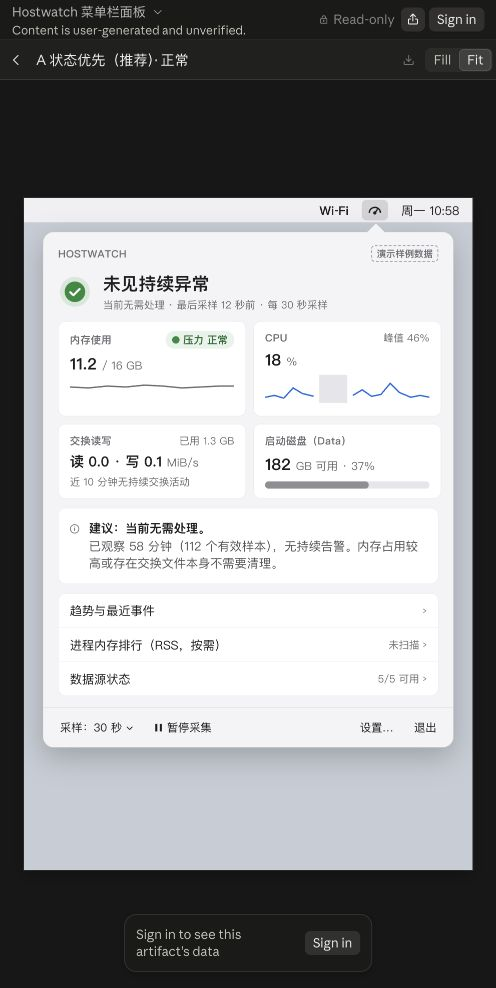
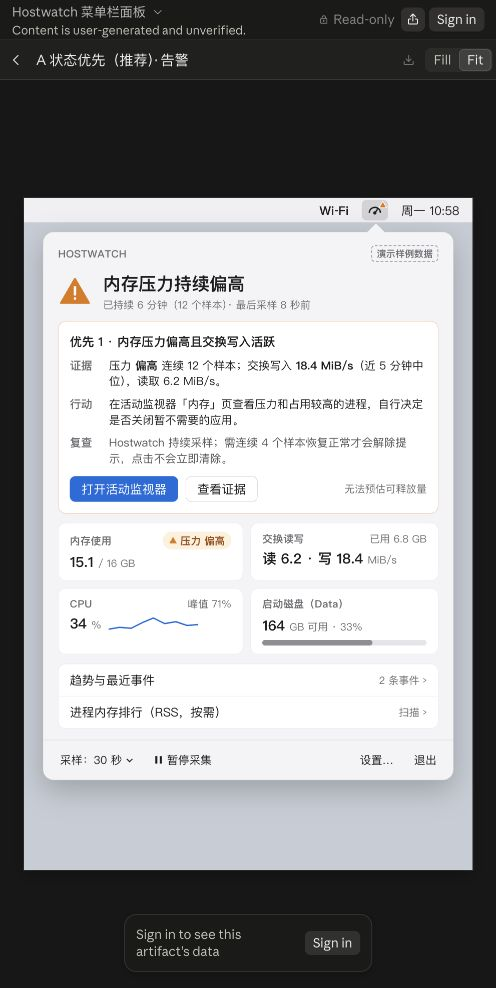
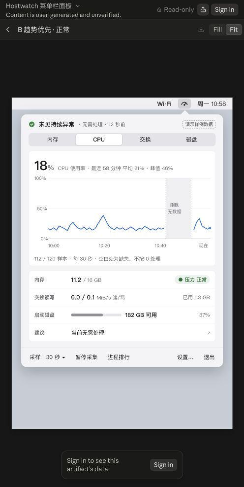
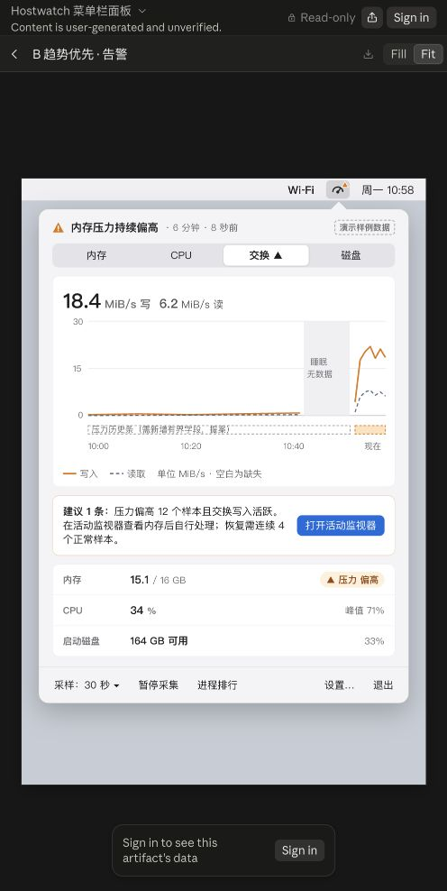
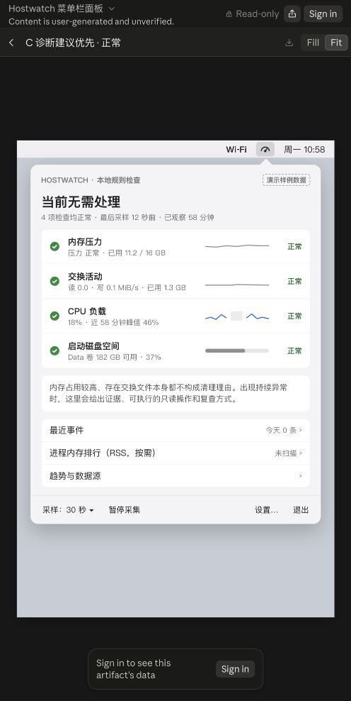
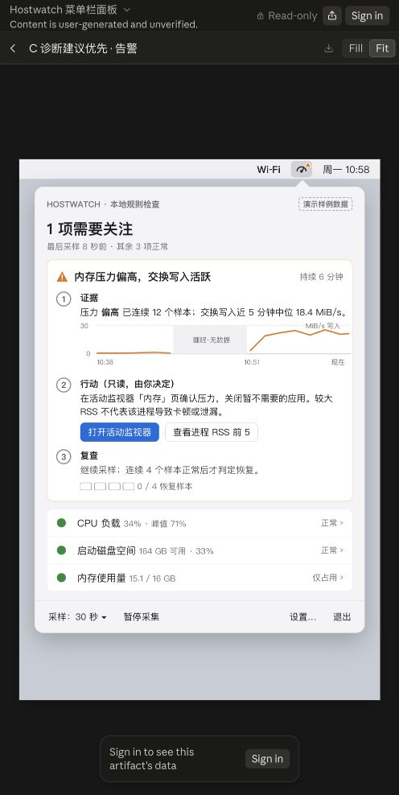

# Hostwatch：Claude Design 六画板评审

日期：2026-10-19。来源：[用户提供的 Claude Design](https://claude.ai/artifact/Y6pBFi1m5du5nR5jre8HQS#page-dcb81aee8d83)。本次通过浏览器实际打开、逐张放大查看并保存截图；未修改原设计或产品实现。

## 最新用户方向：极简优先

用户在本次评审后明确：极简、简洁、高效、实用，不懂电脑的人也应一眼看懂。**后续不采用 A/B/C 多层组合，改以 A 为基础继续精简成一个主面板。** 最新补充要求：同一轮完成全部必要界面、状态与可点击交互，而非只完成主面板；必要详情渐进展开，不增加首页复杂度。当前设计任务以 [极简设计任务书](../claude-design-menubar-dashboard-brief.md) 为准。以下六画板观察和数据准确性问题仍有效；原先多层组合建议已被本段取代。

## 评审时的方向建议（已由上方最新要求收敛）

这份设计已经清楚表达“菜单栏常驻、点击展开图表、结合证据给出优化建议”的目标，可以进入选定方向后的深化阶段。推荐 **A 作为默认首页，B 作为趋势详情，C 的证据—行动—复查结构作为告警详情**。维持一套组件和导航，不在产品中暴露三个方案切换。

A 的摘要和四个指标块适合日常快速查看；B 的坐标、时间范围和缺失区域最能满足图表阅读；C 的行动链最完整，但较大的诊断卡和连续文字不适合作为始终显示的首页。

这属于视觉方向评审，尚不是可交付原生 UI 或交互验收。点击 A 告警的“查看证据”和 B 正常的“内存”标签后，内容与当前选中指标没有变化，仅焦点变化。展示中明确写了选择方向后再补深色和完整状态，符合第一轮视觉探索定位，不把这些暂缺项认定为已承诺完成的功能缺陷。

## 六步检查与截图

### 1. A 正常：适合作为首页，图表上下文需补充

状态、内存压力与使用量分开表达，正常时明确无需处理；四块指标密度合适。小图没有可见时间范围，CPU 灰色缺口没有可见解释，虽然辅助文本说明了睡眠。建议补简短“近 1 小时”等实际范围，以及缺口说明。不要只靠辅助文本解释视觉上的灰块。

### 2. A 告警：行动突出，正文偏密

主要行动按钮清楚，证据、行动、复查均具备。建议首页只保留核心证据与一条操作建议，长解释进入详情。告警时内存和 CPU 卡片位置、尺寸及图表内容发生变化，建议尽量保持指标位置稳定，降低用户每次重新寻找的成本。

### 3. B 正常：图表最清晰，适合趋势详情

CPU 的百分比纵轴、时间轴、睡眠缺口与当前值关系清楚。适合通过 A 的指标卡进入此页面，保留返回总览的明确入口。“内存”标签点击后仍为 CPU 内容，本次只确认静态视觉，不确认可切换的原型交互。

### 4. B 告警：趋势与证据衔接好，需移除实现说明

交换读写通过实线/虚线区分，避免只靠颜色，缺口标识明确。压力历史带内出现“需新增有界字段”等开发说明，应移到设计交接文档，用户界面只显示压力状态及时间含义。压力历史属于待补数据，不能直接当作当前已有能力。

### 5. C 正常：检查结果清晰，图表权重较弱

四项检查逐条展示，容易理解。不过较多的正常标记与说明文字，弱化了用户希望的可视化趋势。可借用检查项结构，不建议独立作为默认首页。

### 6. C 告警：适合告警详情，计数语义需纠正

证据—行动—复查最完整，适合用户主动展开后阅读。顶部“1 项需要关注，其他 3 项正常”与卡片内容不一致：内存压力和交换活动同时异常，不能把聚合成一条建议理解成只有一个检查项异常；下方“内存使用量”也替代了原四项检查中的“交换活动”。应分别表达建议条数和异常指标数。

## 实施前必须对齐的规则和数据

### P2：恢复条件不能由设计从 2 改成 4

三个告警方向都写“连续 4 个正常样本恢复”，C 还显示 0/4。当前 `src/alerts.rs:25` 的 `recovery_samples` 是 2。除非另行批准规则变更，设计应读取现有策略并展示对应的恢复条件。未知样本不应推进恢复进度。

### P2：告警样例的严重程度与代码不符

A/B 的当前交换读写值是读 6.2 + 写 18.4 = 24.6 MiB/s；`src/advice.rs` 的严重阈值为合计 16 MiB/s。按照当前采样值和策略，应存在严重交换告警，不能仅以“内存压力偏高”的一般提醒遮蔽最高严重程度。可调整样例值来展示 Warning，或者保留数据并画出 Critical；不要通过设计默改阈值。

### P2：聚合建议条数与异常检查项数必须分开

C 告警可以把相关症状合并为一个处理建议，但仍需准确表达两个相关指标异常及最高严重级别。建议文案为“1 条处理建议 · 2 项指标异常”，具体由真实评估结果生成；不要硬编码“其余 3 项正常”。

### 待补数据，不是现成能力

- `src/alerts.rs:145–150` 的历史只记录总交换流量，没有分别保存换入/换出速率，也没有压力状态。B 的双线历史、压力带需要扩展有界历史。
- “近 5 分钟中位写入 18.4 MiB/s”需要独立窗口统计；当前聚合趋势并不提供这一指标。先明确窗口、缺失数据与样本不足口径，再决定新增或改为已有当前值。
- A 的“数据源 5/5”不能写死。当前采集有 hw.memsize、VM、CPU、swap、pressure、statfs 六个来源；最终数字应依据实时 source 列表。
- 样例的“58 分钟、每 30 秒、112 个有效样本”和同一范围内“9 分钟睡眠无数据”需要统一。不要为好看手工拼接互相冲突的时间与样本数。
- GB 与 GiB 要统一真实换算；当前 CLI 的容量主要用 GiB。图稿写 GB 可以作为产品选择，但实现必须做十进制转换，不能仅改单位标签。

## 可访问性与验收边界

可确认的优点：状态配合图标和文字；B 的两条交换曲线使用不同线型；多张图在辅助功能树里有趋势摘要；示例数据清楚标注，未伪装为本机实时读数。

风险：浅灰说明、时间刻度和底部操作在当前画面上偏小偏淡，需在最终原生 1× 尺寸和深色模式下测量；未计算对比度，不能据截图宣称达标。部分详情行在辅助功能树里表现为文字，而非可操作按钮/链接；实现阶段需补语义、焦点和键盘行为。

尚未验证：真实菜单栏图标的展开/收起、面板外点击和 Escape、标签切换与详情导航、打开系统工具、暂停/恢复、退出、VoiceOver 完整流程、深色、受限/失败/预热状态、原生内存与 CPU。网页画板不证明这些能力。

## 给 Claude Design 的下一轮反馈

以 [极简设计任务书](../claude-design-menubar-dashboard-brief.md) 内最新提示词为准：A 为起点，一个紧凑主面板，一句结论、三条资源状态、必要时一条优先建议和一个主要按钮。保留本报告中的规则与数据修正要求，不再按原先 A/B/C 多层结构继续设计。用户已要求本轮交付全部必要界面、状态和可点击交互；完整范围以任务书清单为准。
